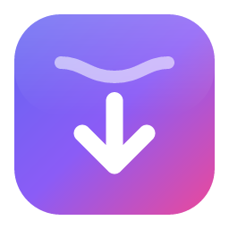

<p align="center">
  
</p>

<h1 align="center">Streamline</h1>

<p align="center">
  Descarga videos y audio de YouTube y más de 1.800 sitios. Sin límites de velocidad y sin anuncios.<br/>
  App de escritorio para <b>macOS</b>, <b>Windows</b> y <b>Linux</b>, impulsada por <a href="https://github.com/yt-dlp/yt-dlp">yt-dlp</a>.
</p>

<p align="center"><a href="https://streamline-iota-sand.vercel.app"><b>streamline-iota-sand.vercel.app</b></a></p>

---

## ✨ Funciones

- **Pega y descarga**: pega un enlace (o cópialo y vuelve a la app, se detecta solo) y elige la calidad.
- **Toda la información antes de descargar**: título, canal, duración, vistas, fecha, miniatura y el **peso estimado** de cada calidad.
- **Todas las resoluciones**: de 144p a 8K, con FPS altos (60 fps) y HDR cuando existen. Contenedor MP4, MKV o WebM.
- **Solo audio**: MP3, M4A, Opus, FLAC o WAV, con carátula y metadatos.
- **Velocidad máxima**: hasta 32 fragmentos en paralelo (`--concurrent-fragments`), re-extracción automática ante throttling y sin límite de ancho de banda.
- **Cola de descargas**: varias descargas simultáneas, con progreso, velocidad y tiempo restante; cancelar, reintentar, abrir el archivo o mostrarlo en la carpeta.
- **Playlists**: elige qué videos descargar y en qué calidad.
- **Extras**: subtítulos incrustados, capítulos, SponsorBlock y cookies del navegador para videos privados o con restricción de edad.
- **Cualquier página web**: pega el enlace de la página y Streamline la lee para sacar el **título del video**, la portada y **todas las calidades** que ofrece el reproductor en su menú (etiquetas `<source>`, la configuración del reproductor o el manifiesto HLS/DASH), aunque la página solo cargue una.
- **Renombrar antes de descargar**: el nombre del archivo se puede editar en la misma pantalla de calidades.
- **Enlaces directos**: para archivos sueltos (`.mp4` de un CDN) genera la miniatura y lee duración, resolución y FPS con ffmpeg.
- **Nombres sin choques**: cada archivo lleva un hash corto (`video [a1b2c3d4].mp4`), así que dos videos con el mismo título nunca se sobrescriben.
- **YouTube con tu sesión**: si YouTube pide confirmar que no eres un robot, un clic usa tu sesión de Brave o Chrome (todas las calidades) o sigue sin sesión hasta 360p.
- **Tema claro y oscuro**, interfaz en español.

## 📦 Instalación

Descarga el instalador de tu sistema. Estos enlaces siempre apuntan a la última versión:

| Sistema | Archivo |
| --- | --- |
| macOS (Apple Silicon) | [`Streamline_aarch64.dmg`](https://github.com/luisfalconmx/streamline/releases/latest/download/Streamline_aarch64.dmg) |
| macOS (Intel) | [`Streamline_x64.dmg`](https://github.com/luisfalconmx/streamline/releases/latest/download/Streamline_x64.dmg) |
| Windows | [`Streamline_x64-setup.exe`](https://github.com/luisfalconmx/streamline/releases/latest/download/Streamline_x64-setup.exe) o [`.msi`](https://github.com/luisfalconmx/streamline/releases/latest/download/Streamline_x64.msi) |
| Linux | [`Streamline_amd64.AppImage`](https://github.com/luisfalconmx/streamline/releases/latest/download/Streamline_amd64.AppImage), [`.deb`](https://github.com/luisfalconmx/streamline/releases/latest/download/Streamline_amd64.deb) o [`.rpm`](https://github.com/luisfalconmx/streamline/releases/latest/download/Streamline.x86_64.rpm) |

**Actualizaciones automáticas:** al abrirse, Streamline consulta el último Release de GitHub. Si hay una versión nueva aparece el botón **Actualizar a vX.Y.Z** arriba a la derecha: descarga la actualización, verifica su firma, la instala sobre la actual y reinicia la app. No hace falta desinstalar nada. En Linux esto funciona con la AppImage; con `.deb`/`.rpm` se instala el paquete nuevo.

> **macOS**: la app no está firmada con un certificado de desarrollador de Apple. Si al abrirla aparece «está dañada», ejecuta una vez:
> ```bash
> xattr -cr /Applications/Streamline.app
> ```

Los instaladores ya incluyen **yt-dlp**, **ffmpeg/ffprobe** y **deno** (yt-dlp necesita un runtime de JavaScript para tener soporte completo de YouTube), así que no hay que instalar nada más.

## 🧱 Stack

| Capa | Tecnología |
| --- | --- |
| Shell de escritorio | [Tauri 2](https://tauri.app) (Rust) |
| UI | React 19 + TypeScript + [Vite](https://vite.dev) |
| Componentes | [HeroUI v3](https://heroui.com) |
| Estilos | Tailwind CSS v4 |
| Motor de descarga | [yt-dlp](https://github.com/yt-dlp/yt-dlp) + ffmpeg + deno (sidecars) |

Se eligió **Vite** en lugar de Next.js porque Tauri sirve archivos estáticos: no hay servidor, SSR ni rutas de API que aprovechar, y Vite da un HMR más rápido y una configuración más simple.

```
streamline/
├── src/                     # Frontend React
│   ├── components/          # Vistas y componentes de UI (HeroUI)
│   ├── lib/                 # Puente con Tauri, formatos y calidades, mock para navegador
│   └── store.tsx            # Estado global: ajustes, cola de descargas e historial
├── src-tauri/               # Backend Rust
│   ├── src/ytdlp.rs         # Ejecuta yt-dlp, parsea el progreso y emite eventos
│   ├── src/scrape.rs        # Lee la página: título, portada y calidades del reproductor
│   ├── binaries/            # Sidecars (se descargan con `pnpm sidecars`, no se versionan)
│   └── tauri.conf.json
├── scripts/                 # Sidecars y publicación (release-*.mjs: instaladores sin versión + latest.json)
├── landing/               # Página de presentación (Vercel, raíz del proyecto: landing/)
├── docker/ + compose.yaml   # Entorno de desarrollo con Docker Desktop
└── .github/workflows/       # CI y release multiplataforma
```

## 🐳 Desarrollo con Docker Desktop

El entorno completo (Rust, Node, pnpm, WebKitGTK) vive en un contenedor. Solo necesitas Docker Desktop.

```bash
docker compose build
```

**UI en el navegador** (backend simulado, ideal para trabajar en la interfaz con hot reload) en http://localhost:1420:

```bash
docker compose up web
```

**App de escritorio real** (Tauri sobre un escritorio virtual con noVNC) en http://localhost:6080/vnc.html?autoconnect=1&resize=remote. Los archivos descargados aparecen en `./downloads`:

```bash
docker compose up desktop
```

**Instaladores de Linux** (`.deb`, `.rpm` y `.AppImage` para la arquitectura de tu máquina), que se copian a `./release/linux`:

```bash
docker compose run --rm build
```

## 💻 Desarrollo nativo (opcional)

Para abrir la ventana nativa en macOS o Windows necesitas [Rust](https://rustup.rs), Node 24 y pnpm:

```bash
pnpm install
```

```bash
pnpm sidecars
```

```bash
pnpm tauri dev
```

## 🚀 Publicar una versión

Las actualizaciones van firmadas: la app solo instala paquetes firmados con la llave privada del proyecto, `~/.tauri/streamline.key` (la pública está en `tauri.conf.json`). **Guárdala en un lugar seguro**: si se pierde, las apps instaladas ya no podrán actualizarse.

Una sola vez, sube la llave como secreto del repositorio para que GitHub Actions pueda firmar:

```bash
gh secret set TAURI_SIGNING_PRIVATE_KEY < ~/.tauri/streamline.key
```

Para cada versión:

1. Actualiza `version` en `package.json`, `src-tauri/tauri.conf.json` y `src-tauri/Cargo.toml`.
2. Crea y sube un tag. El workflow [`release.yml`](.github/workflows/release.yml) compila **Windows y Linux**, firma las actualizaciones y publica el Release con los instaladores (nombres sin versión) y el `latest.json` que lee la app:

```bash
git tag v1.0.0 && git push origin v1.0.0
```

3. Cuando termine, compila **macOS** (Apple Silicon e Intel) en tu Mac. Sube los `.dmg` y las actualizaciones firmadas al mismo Release y las agrega a `latest.json` (requiere Rust y `gh`):

```bash
pnpm release:mac
```

## ⚖️ Licencias de terceros

- [yt-dlp](https://github.com/yt-dlp/yt-dlp): Unlicense.
- [FFmpeg](https://ffmpeg.org): binarios GPL de [yt-dlp/FFmpeg-Builds](https://github.com/yt-dlp/FFmpeg-Builds) (Windows/Linux) y [Martin Riedl](https://ffmpeg.martin-riedl.de) (macOS).
- [Deno](https://deno.com): MIT.

Descarga solo contenido del que tengas derechos o permiso. Respeta los términos de servicio de cada sitio.
